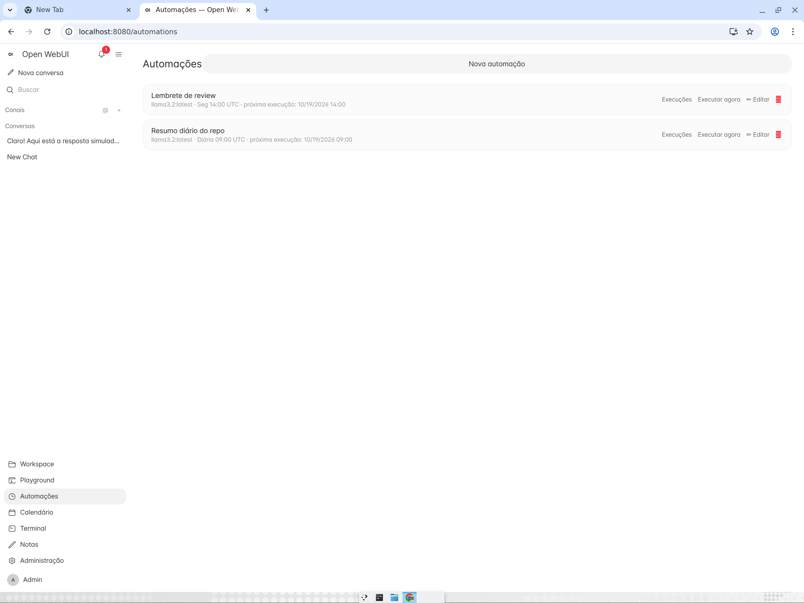
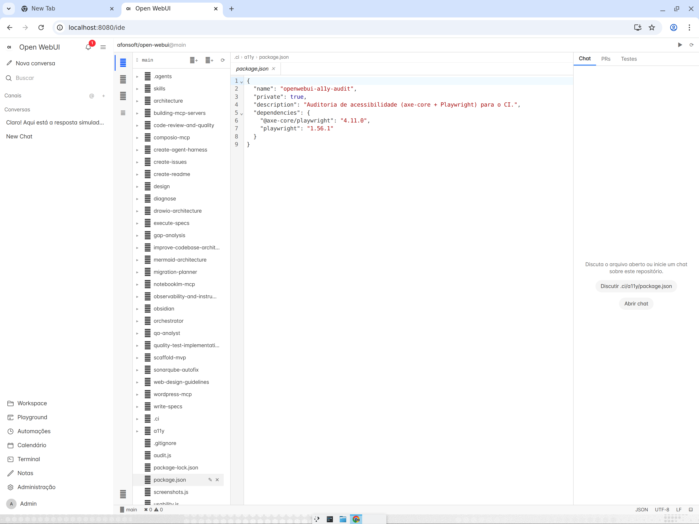
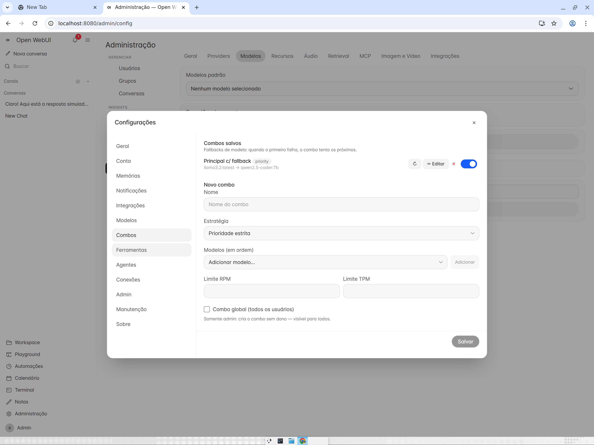
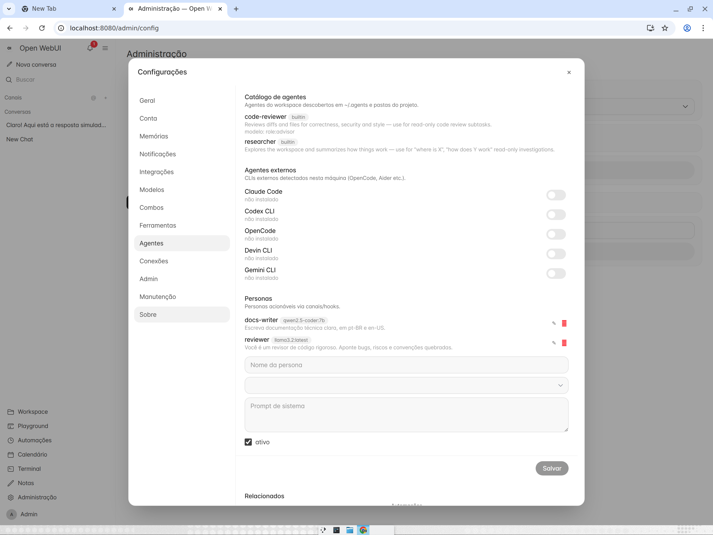

# Open-WebUI+Code — .NET (Coding Agent Edition)

A migration of [Open WebUI](https://github.com/open-webui/open-webui) to
**.NET 10 · C# 14 · Blazor WebAssembly** (SvelteKit + FastAPI → ASP.NET Core + Blazor),
faithful to the original layout and configuration — **extended into a full coding-agent
platform** in the spirit of [opencode](https://github.com/sst/opencode): repo-bound
chats running on dedicated git worktrees, sub-agents in parallel, mid-run steering,
durable memory, scheduled routines, a VS Code-style IDE and a worktree review
pipeline.

[](https://github.com/afonsoft/open-webui/actions/workflows/ci-build-test.yml)
[](https://github.com/afonsoft/open-webui/actions/workflows/code-quality.yml)
[](https://github.com/afonsoft/open-webui/actions/workflows/security-scan.yml)
[](https://github.com/afonsoft/open-webui/actions/workflows/a11y-audit.yml)
[](https://sonarcloud.io/project/overview?id=afonsoft_open-webui)

> **Versão em português:** [README.pt-BR.md](README.pt-BR.md)

## Open WebUI (original) vs opencode vs oh-my-pi vs this fork

The agent roadmap was benchmarked against [opencode](https://github.com/sst/opencode)
(incl. the [alltomatos/opencode](https://github.com/alltomatos/opencode) fork —
see [the full analysis](docs/analise-fork-alltomatos-opencode.md)) and
[oh-my-pi](https://github.com/can1357/oh-my-pi), whose session-tree, advisor and
context-tooling design shaped several features below.

| Capability | Open WebUI | opencode | oh-my-pi | **This fork (.NET/Blazor)** |
|---|---|---|---|---|
| Chat + streaming,<br>multi-provider | ✅ Ollama/OpenAI,<br>RAG/pipelines | ✅ any LLM<br>via gateway | ✅ multi-provider<br>(TUI) | ✅ parity +<br>OmniRoute-friendly |
| Repo/workspace<br>bound to session | ❌ single<br>workspace | ✅ per-project | ✅ per-project | ✅ **per-chat git<br>worktree** — strict<br>scope, global<br>never leaks |
| Sub-agents /<br>parallel sessions | ❌ | ✅ task tool<br>+ sessions | ✅ declarative<br>`.md` task agents | ✅ `delegate_task`<br>(+ `*.agent.md`),<br>depth ≤3, worktree-<br>isolated |
| Review before<br>merge | ❌ | ✅ orchestrator<br>reviews diffs | ❌ | ✅ `worktree_diff` /<br>`worktree_merge` +<br>auto-merge opt-in |
| Steer/queue<br>mid-run input | ❌ | ✅ durable<br>steer/queue | ❌ | ✅ `…/runs/{id}/steer`<br>(steer + queue) |
| Durable agent<br>memory | ❌ | ✅ memory tools<br>+ auto-sync | ✅ memory tools | ✅ `memory_save` /<br>`memory_search` + 6h<br>auto-distill `auto:*` |
| Routines /<br>reminders | ❌ | ✅ routine tool<br>+ scheduler | ❌ | ✅ `routine`/`reminder`<br>+ `once` schedules |
| Task list tool | ❌ | ✅ todo write | ✅ | ✅ `todo_write`,<br>stable ids |
| Context<br>compaction | ❌ | ✅ auto-summarize | ✅ auto + on-demand,<br>with pruning | ✅ LLM summary +<br>pruning + digest +<br>`history://` recovery |
| Parent/child<br>run tree UI | ❌ | ✅ session tree | ✅ session tree | ✅ sidebar tree +<br>badge + parent<br>markers |
| Parallel runs<br>console | ❌ | ✅ | ✅ | ✅ "Active runs"<br>sidebar |
| Runs survive<br>browser close | partial | ✅ | ✅ | ✅ server-side +<br>`Last-Event-ID` |
| Session branching<br>(fork any turn) | ❌ | ❌ | ✅ `parentId` +<br>`/fork` | ✅ `ParentId`/`Leaf`<br>tree + "branch<br>from here" + summary |
| Model roles +<br>fallback chains | ❌ single model | partial | ✅ `modelRoles` +<br>`fallbackChains` | ✅ `tasks`/`memory` /<br>`advisor` + vision<br>capability map |
| Tool approval<br>tiers | binary<br>approve-all | ✅ permission<br>model | ✅ tier + tool policy<br>+ user override | ✅ `Read`/`Write`/`Exec`,<br>fail-closed, per-tool<br>overrides |
| Advisor /<br>watchdog | ❌ | ❌ | ✅ read-only 2nd<br>opinion | ✅ advisor inspects<br>runs, no approval<br>power |
| Agent-directed<br>context | ❌ | partial | ✅ `checkpoint`/`rewind`,<br>`context_notes`,<br>`new_context`,<br>`context_save`/`recovery`/`<br>compact` | ✅ same trio + pruning<br>+ `history://` |
| Layered config +<br>provenance | env + admin UI | partial | ✅ env>runtime>overlay><br>project>global | ✅ global/admin/user<br>layers + source |
| Declarative<br>agent defs | ❌ | ✅ AgentUI | ✅ `.md` + frontmatter | ✅ `*.agent.md` (tools,<br>model, spawns) via<br>`delegate_task` |
| Plan mode →<br>structured output | ❌ | ✅ plan/build<br>modes | ❌ | ✅ `/plan` → **SPEC SDD**<br>markdown; `plan_exit`<br>validates + saves to<br>`.openwebui/plans/` |
| Media attachments<br>in chat | ✅ uploads | partial | ❌ | ✅ composer thumbnails,<br>inline + click-enlarge,<br>vision analysis |

## Screenshots

| Delegated sub-agents in parallel | Session tree + completion markers |
|---|---|
|  |  |

| Active-runs console | Sub-session with parent link + approval |
|---|---|
|  |  |

| Per-chat repo binding | Routines & reminders |
|---|---|
|  |  |

| VS Code-style IDE | Model combos | Agents & personas |
|---|---|---|
|  |  |  |

| Chat (light/dark) | Workspace panel | Terminal PTY |
|---|---|---|
|  |  |  |

## Agent features (new — additive layer over upstream parity)

- **`delegate_task`** — spawns a child chat + server-side run: `wait:false` returns
  `childRunId` immediately, `wait:true` (default) blocks up to 300s; `repo` and
  `persona` (a workspace Skill as system prompt) params; depth ≤ 3; each sub-agent
  inherits the parent repo but works in its **own chat-scoped worktree**.
- **Per-chat repo worktrees** — binding a chat to `owner/repo` creates an exclusive
  worktree (`workspaces/{user}/worktrees/{owner}__{repo}/{chatId}`, branch
  `chat/{chatId}`) over a shared base checkout; resolution is strict per chat —
  a new conversation never inherits your global binding. Unbind/archive/delete
  releases the worktree; the base checkout leaves disk when unreferenced, and a
  diverged base self-heals (diverged HEAD preserved as `backup/*`).
- **Three agent modes** — composer selector `chat` / `plan` / `build`: `chat` is
  repo-free (workspace tools denied), `build` requires a bound repo (`PATCH` 400
  otherwise; unbind drops `build`→`chat`; `plan_exit` only promotes with binding).
  Workspace gate covers `delegate_task`, `lsp_*` and `skill`; the format hook
  honors the chat binding's `FormatCommand`.
- **Autonomous decisions** — `smart`/`auto`/`always-allow` presets auto-answer
  `ask_user` prompts that carry options (recommended option, else first) without
  pausing the run; every auto choice emits an auditable `decision_auto` event.
- **Mobile workspace** — touch targets and collapsing chips keep the workspace
  panel, repo picker and IDE reachable on small screens.
- **`run_result` / `worktree_diff` / `worktree_merge`** — collect async results,
  review the child diff, merge explicitly (or `auto_merge` opt-in).
- **Steer & queue** — `POST /api/v1/chats/{id}/runs/{runId}/steer` injects a user
  message into a live run (`steer` = next turn boundary, `queue` = when idle).
- **Agent memory** — `memory_save`/`memory_search` (project + global scopes),
  auto-injected `<agent_memory>` block; 6h scheduler distills durable facts into
  `auto:*` memories with per-user watermark + opt-out.
- **Routines & reminders** — `routine` tool (list/create/update/delete/run_now,
  `once`/`interval`/`daily`/`weekly`) and `reminder` (fires an
  `automation.reminder` notification) over the built-in Automations engine.
- **Context compaction** — when history grows, the pipeline summarizes old turns
  through the configured model and keeps a cutoff kv per chat.
- **Plan mode → SPEC SDD** — `plan` mode (or the `/plan` slash builtin) analyses
  the requirement read-only, then emits a full SPEC SDD markdown: metadata,
  user story, scope, `RF-###` requirements, BDD acceptance criteria, task plan,
  DoD and open questions. `plan_exit` validates the structure (incomplete plans
  are refused with the missing sections), persists to `.openwebui/plans/` and
  only promotes to `build` on user approval.
- **Model roles + fallback chains** — dedicated models for `tasks` (titles,
  follow-ups, tags, compaction), `memory` (distillation) and `advisor`; each
  role resolves through a capability map (e.g. vision) with an ordered fallback
  chain, configurable per layer.
- **Fine-grained tool approval tiers** — every tool declares `Read`/`Write`/
  `Exec` (fail-closed `Exec`); per-tool user overrides can relax but never
  weaken a tool-level deny.
- **Run advisor (watchdog)** — a secondary, read-only model reviews the live
  transcript, can inspect the workspace with its own read tools and injects
  guidance mid-run — with no approval or mutation power.
- **Agent-directed context** — `checkpoint`/`rewind` tool pair (mark → explore
  → collapse), `context_notes` (per-branch notebook that survives rollover) and
  `new_context` (on-request compaction); mechanical pruning elides superseded
  tool results and `history://` URIs recover full pre-compaction turns.
  `context_save`/`context_recovery`/`context_compact` persist versioned context
  snapshots per chat (table `ContextSnapshots`) and compaction auto-triggers at
  `compaction:threshold_tokens` estimated tokens (~256k-token window).
- **Chat branching** — messages form a tree (`ParentId`/`LeafMessageId`);
  "branch from here" forks any turn into a sibling chat, with a branch summary
  for the abandoned path.
- **Declarative agents** — `*.agent.md` files (frontmatter: tools, model,
  spawns) discovered in the repo define named sub-agents, spawnable through
  `delegate_task(agent: "…")`.
- **Layered configuration** — effective settings resolve through
  global → admin → user layers with per-key provenance.
- **Memory pipeline** — scheduled consolidation distills session outcomes into
  the durable memory layers that are re-injected into new runs.
- **Chat media attachments** — image/video thumbnails inside the composer,
  acceptable inline size after send, click-to-enlarge; attached images are
  always analyzed together with the prompt by a vision-capable model.
- **Model combos (failover)** — `priority` / `round-robin` /
  `priority-round-robin` strategies over ordered model lists, shared RPM/TPM
  limits and per-model cooldown; user-scoped or admin-global, managed under
  Settings → Combos.
- **Agent personas** — named personas (system prompt, model, guardrail level,
  tool allowlist) invocable via channels/hooks with a per-persona audit log.
- **External agent registry** — detects local agent CLIs (Claude Code, Codex,
  OpenCode, Devin, Gemini) and bridges them into delegated runs.
- **Global `~/.agents` scope** — skills, commands and `mcp.json` are discovered
  from `~/.agents` plus project `.claude`/`.agents` dirs and merged with the
  workspace catalog.
- **Multi-question `ask_user` forms** — one prompt can carry several questions
  with `options`/`multiple`/`reject`; autonomy presets auto-answer per
  question.
- **Parallel tool calls** — tools marked `SafeInParallel` execute
  concurrently inside a single provider round.
- **Provider resilience** — retry with backoff, `finish_reason=length`
  continuation and context-overflow recovery inside the run pipeline.
- **Durable runs** — persisted run events, checkpoint replay and heartbeat
  ownership: a live run survives an API restart and resumes on drain.
- **Run steps + usage/cost** — per-agent step feed, last-step wrap-up and
  usage/cost metadata per run; the workspace **Changes** tab shows the run
  diff including changes the agent committed.
- **Command expansion** — server-side expansion of repo/workspace slash
  commands with per-run overrides.
- **Web search failover** — `auto` mode rotates across configured providers
  with a per-provider cooldown.
- **Bounded tool output** — oversized tool results spill to a managed file
  (`builtin:big_output`) instead of flooding the context window.
- **Markdown source view** — view/source toggle and copy on assistant
  messages.
- **Agent secrets env** — key→value secrets (admin-global + per-user
  overrides) injected into `shell_exec` jobs and the terminal; the GitHub
  token from the integration is included by default.
- **Browser visual loop** — Playwright browser tools
  (`browser_navigate`/`browser_observe`/`browser_act`/`browser_screenshot`)
  with local OCR for visual-reasoning loops.
- **Settings redesign** — categorized sections (Combos, Agentes, Manutenção,
  …) with a unified save bar.
- **Retention** — daily purge (automation runs >90d, notifications >60d, steers of
  terminal runs >30d) + worktree orphan prune + WAL checkpoint + weekly VACUUM;
  the **Manutenção** settings tab adds chat/memory retention with dry-run and
  "run now".
- **Chat hierarchy** — `ParentChatId`/`ParentRunId`, `GET /chats/{id}/children`,
  nested sidebar tree, completion markers posted back to the parent chat.

Full details per feature (with screenshots): [docs/en/AGENT-FEATURES.md](docs/en/AGENT-FEATURES.md) · [docs/pt/RECURSOS-AGENTE.md](docs/pt/RECURSOS-AGENTE.md)

## Classic features (upstream parity)

- **Chat** with SSE streaming (Ollama / OpenAI-compat), attachments, 👍/👎,
  editing, regeneration, LLM-generated title/follow-ups/tags
- **Decoupled runs** — responses execute server-side; closing/reloading the tab
  does not interrupt; on reopen the client reattaches with `Last-Event-ID` replay
- **Notifications** — in-app toasts, Notification API and Web Push (VAPID)
- **Tool streaming + approval gate** — `tool_call`/`tool_result` on SSE, approval
  presets per chat (readonly/approve/always/**auto by risk** LOW-MED-HIGH), deny
  with instructions for the model to correct course
- **Builtin tools** — `shell_exec` + background jobs, `file_*` (list/read/grep/
  glob/write/edit with diff), `code_interpreter`, `fetch_url`, `web_search`,
  `generate_image`/`generate_video`, `browser_screenshot`, `ask_user`,
  `n8n_list_workflows`/`n8n_trigger`, `todo_write`, `skill`, `lsp_*`, `plan_exit`
- **Workspace panel** — Tasks, Changes (git diff), Jobs, MCPs, Terminal (PTY) and
  run Info; draggable resizer; `/ide` full-screen view
- **Chat/Plan/Build agent modes** + permission modes; **checkpoints & revert**;
  **pause/resume** runs; slash commands from repo skills
- **RAG, Knowledge, Arena, Channels/Notes/Calendar, Admin (users, connections,
  MCP servers, integrations), i18n in 8 locales, PWA offline shell**

## Quickstart

```bash
dotnet restore OpenWebUI.slnx
dotnet build OpenWebUI.slnx --configuration Release
dotnet run --project src/OpenWebUI.Api   # http://localhost:8080
```

Docker (`:3032 → :8080`) — published **multi-arch image (amd64 + arm64)** on
[Docker Hub](https://hub.docker.com/r/afonsoft/open-webui) and GHCR:

```bash
docker run -d -p 3032:8080 -v openwebui-data:/data afonsoft/open-webui
# or compose against the published image (no clone needed)
curl -LO https://raw.githubusercontent.com/afonsoft/open-webui/main/docker-compose.hub.yaml
docker compose -f docker-compose.hub.yaml up -d
# or build from source
docker compose up -d --build
```

`docker-compose.prod.yaml` ships a production layout with watchtower
auto-updates (5min poll).

Full Docker guide: [docs/en/DEPLOY-DOCKER.md](docs/en/DEPLOY-DOCKER.md) ·
[docs/pt/DEPLOY-DOCKER.md](docs/pt/DEPLOY-DOCKER.md)

## Tests

```bash
dotnet test OpenWebUI.slnx   # 1900+ API tests + client tests (NUnit)
```

Coverage gate via Coverlet + ratchet (`.ci/coverage-baseline.txt` only goes up).

## Quality & CI

| Workflow | Covers |
|---|---|
| `ci-build-test.yml` | Release build, all tests + coverage gate, WASM payload, tailwind freshness, Docker build, baseline ratchet |
| `a11y-audit.yml` | axe-core (Playwright) mobile+desktop |
| `code-quality.yml` | Qodana + [SonarCloud](https://sonarcloud.io/project/overview?id=afonsoft_open-webui) |
| `security-scan.yml` | CodeQL (C#+JS), Trivy, GitGuardian, Snyk |
| `release.yml` | Tag `vX.Y.Z` → multi-arch (amd64+arm64) GHCR + Docker Hub image |

## Documentation

- [docs/en/AGENT-FEATURES.md](docs/en/AGENT-FEATURES.md) — agent platform details (EN)
- [docs/pt/RECURSOS-AGENTE.md](docs/pt/RECURSOS-AGENTE.md) — detalhes do modo agente (PT-BR)
- [docs/MIGRACAO-DOTNET.md](docs/MIGRACAO-DOTNET.md) — upstream → .NET parity map
- [docs/architecture/architecture.md](docs/architecture/architecture.md) — architecture (Mermaid)
- [docs/analise-fork-alltomatos-opencode.md](docs/analise-fork-alltomatos-opencode.md) — opencode-fork analysis that drove the agent roadmap
- `.specs/` — in-flight SPECs; `docs/specs/` — delivered SPECs
- [CHANGELOG.md](CHANGELOG.md)

## Star History

[](https://www.star-history.com/?repos=afonsoft%2Fopen-webui&type=date&legend=bottom-right)

## License

BSD-3-Clause — see [LICENSE](LICENSE).
