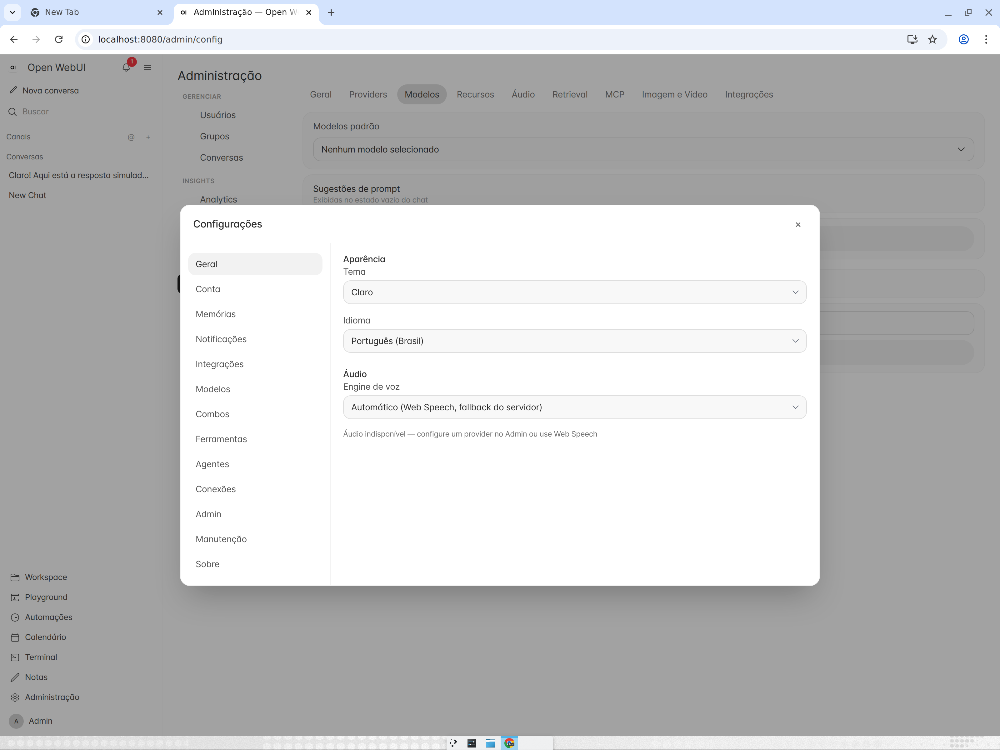
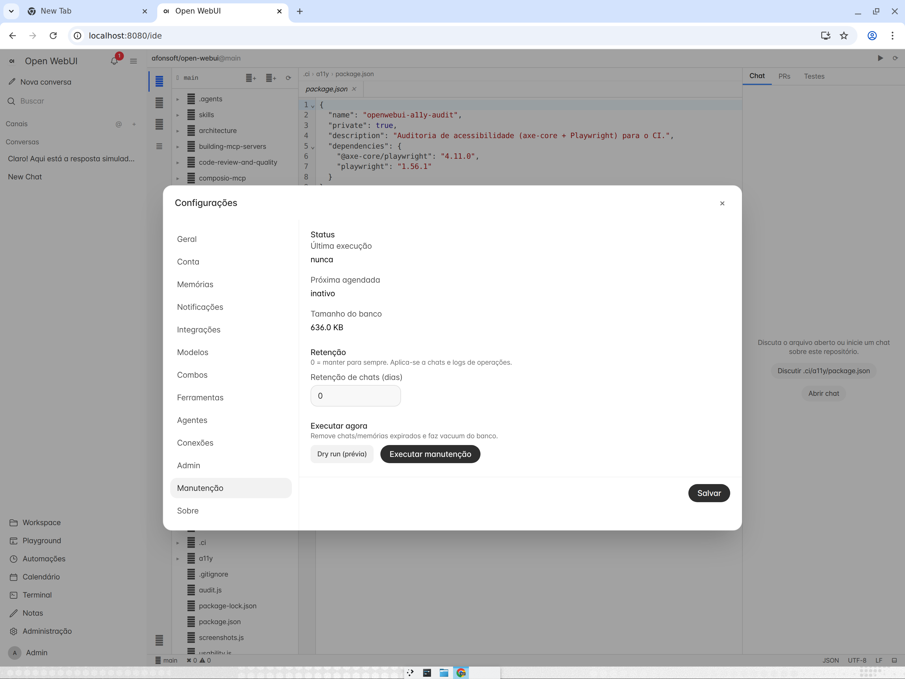

# Agent features — detailed guide

Everything below is an **additive layer** on top of upstream parity: no core
gateway/route was restructured. Each item lists the surface (tool/endpoint/UI),
the behavior, and where it shows on screen.

## 1. `delegate_task` — sub-agents and parallel sessions

Spawns a child **chat** plus a server-side **run**.

```jsonc
// tool arguments
{
  "prompt": "Write hello-api.txt containing exactly: api",
  "wait": false,              // false → returns { childRunId, childChatId } now
  "repo": "owner/other-repo", // optional — bind the child to another repo
  "persona": "reviewer",      // optional — a workspace Skill used as system prompt
  "auto_merge": false         // optional — merge the child worktree when done
}
```

- `wait:false` → async: the child run is collected later with `builtin:run_result`.
- Depth is capped at **3** (`MaxDepth`), walked up the `ParentRunId` chain.
- The child inherits the parent's repo/branch but gets its **own chat-scoped
  worktree** (`workspaces/{user}/worktrees/{owner}__{repo}/{childChatId}`,
  materialized lazily) — parallel workers never write to the same checkout.
- The child inherits the parent's **per-chat repo binding** unless `repo` overrides.


## 2. Session/run hierarchy

- Schema: `Chat.ParentChatId`, `ChatRun.ParentRunId`.
- API: `GET /api/v1/chats/{id}/children` → child chats + `lastRunStatus`.
- Sidebar: a "Subtarefas" expander nests children under the parent with a
  `delegado` badge; the child header links back to **Chat pai**.


When a child run reaches a terminal status, the dispatcher appends a marker
message to the **parent** chat — `Subtarefa concluída (completed): … — run
{id}. Resultado completo via builtin:run_result.` — so the parent's next turn
sees the outcome in-context.


## 3. Review before merge (worktree pipeline)

Because each sub-run lives in its own worktree, review is explicit:

- `builtin:worktree_diff` — returns the child worktree diff vs. the base branch.
- `builtin:worktree_merge` — merges the worktree branch back (`--no-ff` style,
  then cleans the worktree).
- `delegate_task` with `auto_merge:true` skips review and merges on success.

Orphaned worktrees are pruned at boot and daily (retention, below).

## 4. Steer & queue mid-run input

`POST /api/v1/chats/{chatId}/runs/{runId}/steer`

```jsonc
{ "message": "also update the README", "mode": "steer" } // or "queue"
```

- `steer` — injected at the next provider-turn boundary of the live run.
- `queue` — admitted only when the run would otherwise go idle.
- Rows are durable (`ChatRunSteers`); steers of terminal runs are purged after
  30 days by retention.

## 5. Parallel-runs console

`GET /api/v1/chats/runs` returns the latest 50 runs across chats
(`ParallelRunResponse` with `ParentRunId`/`ParentChatId`). The sidebar renders an
**"Runs ativas"** section for queued/running/paused entries — one click opens
the owning chat.


## 6. Agent memory (durable + auto-sync)

- Tools: `builtin:memory_save` (title, content, scope `project|global`) and
  `builtin:memory_search` (query → ranked memories).
- Injection: the pipeline prepends an `<agent_memory>` block with the relevant
  memories to the system prompt.
- **Auto-sync** (`MemorySyncService`, 6h tick): for each user, chats updated
  since the kv watermark `u:{uid}:memsync.last` are distilled by the configured
  model into `auto:*` memories (25 newest kept). Opt out with
  `u:{uid}:memsync.enabled=false`; the watermark only advances on provider
  success, so failures retry on the next tick.

## 7. Routines & reminders

Built on the Automations engine (entity + 15s scheduler + REST CRUD at
`/api/v1/automations`, page **Automações** in the sidebar):

- `builtin:routine` — `list|create|update|delete|enable|disable|run_now` with
  `schedule` = `once | interval | daily | weekly` (`once` accepts
  `in_minutes` or epoch `run_at`).
- `builtin:reminder` — one-shot message → `once` automation; when it fires it
  also dispatches an `automation.reminder` notification to the user's feed.


## 8. Context compaction

Long chats are compacted inside the run pipeline: old turns are summarized by
the configured model and a per-chat cutoff key (`chat:{id}:compact.*`) tells the
next run to replay `[summary] + tail` instead of the full history.

## 9. Data retention

`RetentionService` (24h tick) keeps the SQLite store lean:

- `AutomationRuns` older than **90 days**, `Notifications` older than **60 days**,
  `ChatRunSteers` older than **30 days** **and** whose run is terminal.
- Worktree orphan prune (same rules as the boot-time sweep), WAL
  `checkpoint(TRUNCATE)`, and a weekly `VACUUM` guarded by kv `sys:vacuum.last`.
- Never touches chats, messages, files or memories.

## 10. Per-chat repo worktrees

- kv `chat:{id}:workspace.repo` resolves **strictly per chat** — `chat` or
  `none`. A new conversation never inherits the user-global binding
  (`Source` reported back); without a `chatId`, resolution falls to the
  user-global binding (`user` | `none`).
- Binding a chat to `owner/repo` creates an **exclusive git worktree** at
  `workspaces/{user}/worktrees/{owner}__{repo}/{chatId}` on branch
  `chat/{chatId}`, checked out from a shared base clone in
  `repos/{owner}__{repo}`.
- `GET`/`PUT /api/v1/chats/{id}/workspace-repo` (owner-only). `PUT` with an
  empty/null repo **unbinds**: the worktree is removed, the chat drops out of
  `build` (→ `chat`), and the base checkout leaves disk once no chat or the
  global binding references it.
- Archiving keeps the binding kv and recreates the worktree lazily on first
  use after unarchive; deleting releases everything.
- If the shared base checkout diverges from `origin` (stale local commits),
  the next bind self-heals: the diverged HEAD is preserved as
  `backup/{branch}-{ts}` and the base is reset to the fetched ref — a dirty
  tree still reports the honest pull error.
- All workspace surfaces — tools in a run, `/ide`, file tree, git bar,
  test-run, skills/commands — honor `?chatId=`.
- `delegate_task` inherits the parent's repo/branch into a fresh child
  worktree (or `repo` overrides).


## 11. Three agent modes (chat / plan / build)

- The composer exposes a mode selector persisted per chat (`PATCH
  /api/v1/chats/{id}` with `mode`).
- **`chat`** (default) — repo-free conversation: workspace tools
  (`file_*`, `shell_exec`, `delegate_task`, `lsp_*`, `skill`, …) are denied
  and not advertised to the model.
- **`plan`** — read-only planning: only read/list/grep/glob, web/fetch,
  `ask_user`, `todo_write` and `plan_exit` builtins run (external HTTP/MCP
  tools denied); `plan_exit` is advertised only in this mode.
- **`build`** — full workspace access gated by the approval preset,
  **requires a bound repo**: `PATCH` returns `400` without one; `plan_exit`
  only auto-promotes to `build` when a binding exists; unbinding a repo
  drops a persisted `build` back to `chat`.
- Pending repo selection: picking a repo in a brand-new chat stays pending
  until the first send, then materializes as a **chat binding** — it never
  writes the user-global binding.
- Custom `TestCommand`/`FormatCommand` are inherited from the previous chat
  binding (or the global one) when the chat first binds.

## 12. Autonomous decision pick

- Approval presets `smart` / `auto` / `always-allow` auto-answer `ask_user`
  prompts that carry options — the recommended (marked) option, else the
  first — without pausing the run.
- Every auto choice emits an auditable `decision_auto` SSE event rendered in
  the run activity feed.

## 13. Model combos (failover)

`GET`/`POST`/`PUT`/`DELETE /api/v1/combos[/{id}]` (+ `/{id}/status`)

- A combo is an **ordered list of models** resolved under one of three
  strategies: `priority` (always the first healthy), `round-robin`, or
  `priority-round-robin`. When the current model fails, the combo tries the
  next ones; a failing model enters a per-model **cooldown** (max 5min).
- Shared rate limits per combo: `requestsPerMinute` and `tokensPerMinute`
  enforced over a sliding 60s window.
- User-scoped by default; admins can create **global combos** (no owner —
  visible to everyone). Managed under **Settings → Combos**.


## 14. Agent personas

`GET`/`POST`/`PUT`/`DELETE /api/v1/agent-personas[/{id}]` (+ `/{id}/message`,
`/{id}/audit`)

- A persona is a named agent profile: `systemPrompt`, `modelId`,
  `guardrailLevel` (`basic`/`strict`) and an optional tool allowlist.
- Personas are invocable via channel dispatch/hooks and through
  `delegate_task(persona: "…")`; every dispatch is recorded in the persona's
  audit log (`GET /{id}/audit`).
- Managed under **Settings → Agentes**, next to the agent catalog and the
  external-agent registry.


## 15. External agents & the global `~/.agents` scope

- **External agent registry** — `GET /api/v1/external-agents/detect` scans the
  host for agent CLIs (Claude Code, Codex CLI, OpenCode, Devin CLI, Gemini
  CLI). Detected CLIs can be enabled per user and bridged into delegated runs.
- **Agent catalog** — `builtin:agent_catalog` lists workspace agents
  discovered from `*.agent.md` files and builtin roles (`code-reviewer`,
  `researcher`).
- **Global scope** — skills, slash commands and `mcp.json` are discovered from
  `~/.agents` (plus `.claude`/`.agents` project dirs and `*.md` agent files)
  and merged with the repo/workspace catalog.

## 16. Multi-question `ask_user` forms

- A single `ask_user` call can carry **several questions**, each with its own
  `options`, `multiple` select and `reject` affordance — rendered as one form.
- Autonomy presets answer per question (recommended option, else first);
  every auto answer is still emitted as `decision_auto`.

## 17. Run durability, resilience & throughput

- **Durable run events** — run events are persisted; **checkpoint replay**
  rebuilds stream state and **heartbeat ownership** lets a restarted API
  adopt orphan runs instead of abandoning them (`run-recovery`).
- **Provider resilience** — retry with backoff on transient failures,
  automatic continuation on `finish_reason=length`, and context-overflow
  recovery (shrink-and-retry) inside the run pipeline.
- **Parallel tool calls** — tools flagged `SafeInParallel` execute
  concurrently within one provider round; unsafe tools still run serially.
- **Per-agent steps + usage/cost** — runs expose a per-agent step feed, a
  last-step wrap-up, and usage/cost metadata (`run.usage`/`run.cost` meta).
- **Bounded tool output** — oversized results are clipped and spilled to a
  managed file retrievable via `builtin:big_output`, keeping the context
  window intact.
- **Web search failover** — `auto` mode rotates across configured providers
  with a per-provider cooldown.
- **Command expansion** — repo/workspace slash commands are expanded
  server-side with per-run overrides.

## 18. Workspace & UX refinements

- **VS Code-style IDE** (`/ide`) — Explorer/Search/SCM/Outline/Zen views over
  the chat-bound worktree, editor tabs, and Chat/PRs/Tests side panels.


- **Workspace Changes tab** — shows the **run diff**, including changes the
  agent committed on the worktree branch (not just the working tree).
- **Markdown source view** — assistant messages toggle between rendered
  markdown and raw source, with copy.
- **Agent secrets env** — key→value secrets configured at admin-global and
  per-user level are injected into `shell_exec` jobs and the workspace
  terminal; the GitHub token from the integration is included by default.
- **Browser visual loop** — `browser_navigate`/`browser_observe`/
  `browser_act`/`browser_screenshot` (Playwright) with local OCR for
  visual-reasoning loops.
- **Settings redesign** — the modal uses categorized sections (Combos,
  Agentes, Manutenção, …) with a unified save bar.



## 19. Maintenance (chat retention)

- **Settings → Manutenção** — per-user chat/log retention (days), database
  size, last/next scheduled run, plus **dry run** preview and **run now**.
- The scheduled pass removes expired chats/memories (distilling durable facts
  first) and vacuums the database — on top of the global `RetentionService`
  sweep from section 9.



## API quick reference

| Surface | Route |
|---|---|
| Enqueue a run | `POST /api/v1/chats/{id}/messages` |
| Steer/queue | `POST /api/v1/chats/{id}/runs/{runId}/steer` |
| Resume stream | `GET /api/v1/chats/{id}/runs/{runId}/stream?lastSeq=` |
| Run diff | `GET /api/v1/chats/{id}/runs/{runId}/diff` |
| Children | `GET /api/v1/chats/{id}/children` |
| Active runs | `GET /api/v1/chats/runs` |
| Repo binding | `GET`/`PUT /api/v1/chats/{id}/workspace-repo` |
| Automations | `GET`/`POST`/`PUT`/`DELETE /api/v1/automations[/{id}]` (+ `/run`, `/run-now`) |
| Combos | `GET`/`POST`/`PUT`/`DELETE /api/v1/combos[/{id}]` (+ `/{id}/status`) |
| Personas | `GET`/`POST`/`PUT`/`DELETE /api/v1/agent-personas[/{id}]` (+ `/{id}/message`, `/{id}/audit`) |
| External agents | `GET /api/v1/external-agents/detect` |
| Memories | via `builtin:memory_*` tools |
